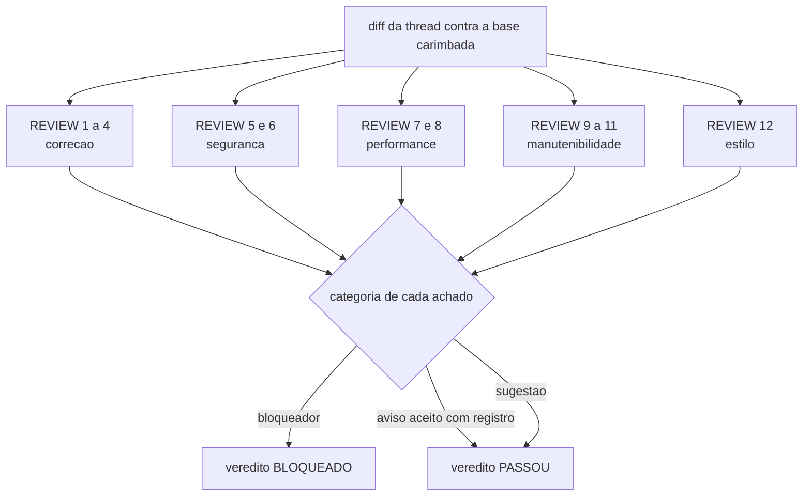

# Code Review Axes

The five axes the CHECK walks through and the rule that categorizes every finding. No axis is optional:
an axis without findings comes out as an explicit "none", because silence is not evidence that anyone looked.
Items are numbered only once across the whole file. Cite an item as `REVIEW 7`.

**Sources:** `core/src/verify.ts`, `core/src/gates.ts`, `core/src/claims.ts`,
[definition-of-done.md](definition-of-done.md), [security-checklist.md](security-checklist.md).

## Axis 1, correctness

| # | Check | How it is proven |
|---|---|---|
| 1 | The code does what the PLAN said it would do, and what it does not do is stated. A difference between what was delivered and what was planned is a finding, even when what was delivered is better. | Diff against the PLAN tasks. |
| 2 | Edge cases declared in the PLAN have a test or a line saying why they do not. | Suite rerun by `ork verify <thread>`. |
| 3 | Errors are not swallowed: every failure path either handles the error, or propagates it with context, or fails loudly. An empty catch is a blocker. | Reading of the diff, backed by the failure-path tests. |
| 4 | No file or test cited by the runtime is missing from the diff. A citation without backing is a hallucination, categorized as a blocker. | `ork verify <thread>`, which reruns the claims on the real HEAD. |

## Axis 2, security

| # | Check | How it is proven |
|---|---|---|
| 5 | The list in [security-checklist.md](security-checklist.md) was walked through over the scope of the diff and of the branch history, and the result is in the report. | The security section of the CHECK report, citing `SEC n` per finding. |
| 6 | Zero security blockers. This is a hard condition: with one open blocker the verdict is BLOQUEADO (blocked), in any conduction mode, including `#Auto`. | The report's verdict against the blocker count. The mode loosens the pause, never the verification. |

## Axis 3, performance

| # | Check | How it is proven |
|---|---|---|
| 7 | The asymptotic cost of the touched structures was examined when the diff changes a loop over a collection that grows with use, and the finding brings the order of magnitude, not an adjective. | Reading of the diff, with the measured number when there is a way to measure. |
| 8 | A performance regression is only asserted with a measurement. Without a measurement, the item comes out `unavailable` with the reason, never as a guess presented as data. | [performance-checklist.md](performance-checklist.md) and the declared origin of each number. |

## Axis 4, maintainability

| # | Check | How it is proven |
|---|---|---|
| 9 | Names say what the thing is, and new code looks like the code around it: same comment density, same human language, same language for names. Code that needs a guided tour to be read is a finding. | Reading of the diff against the neighboring files. |
| 10 | Introduced duplication was pointed out together with the place it should come from. Pointing out duplication without pointing to its owner is an empty suggestion. | Diff against the module that already solves the problem. |
| 11 | The diff carries no change outside the thread's scope. An opportunistic improvement without a task is scope creep, and it becomes a proposal, never a hidden commit. | `git show --stat` against the PLAN's `touch_paths`. |

## Axis 5, style

| # | Check | How it is proven |
|---|---|---|
| 12 | The project's lint and formatter pass, and what they do not cover follows the convention of the neighboring file. Style never becomes a blocker on its own: it is a suggestion, except when it breaks a project tool, and then it is already a correctness issue. | The manifest's `verify:` commands. |

## The categorization rule

Every finding, on any axis, comes out with exactly one category.

- **Blocker**: prevents the merge. A correctness defect, a hallucination proven with evidence, a security
  blocker, a public contract break without ratification.
- **Warning**: passes only with a named record of who accepted it and why. A warning accepted without a record
  is the same as a hidden warning.
- **Suggestion**: holds nothing up and needs no record; it becomes a roadmap proposal when it matters.

A finding without a category does not exist: it is opinion. And a category is not negotiated out of haste: a blocker
downgraded to a warning because the delivery was close is the process defect that this axis exists
to make visible.

## Recommendations (not a gate on this machine)

- Static analysis beyond lint (cyclomatic complexity, tool-based duplication detection):
  this repository does not have those tools, so axes 4 and 5 are walked through by reading and the
  report says so, instead of reporting a number that nobody produced.
