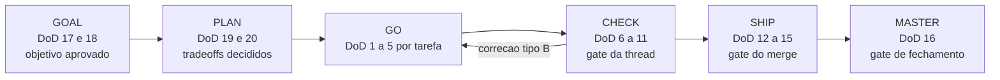

# Definition of Done

The universal conditions a delivery meets before it is called done. It consolidates the gates
the `ork` core already runs and invents no doctrine of its own. Items are numbered only once
across the whole file, so that a reviewer writes a number and every human and every skill resolve to the
same line. Cite an item as `DoD 4`.

**Sources:** `core/src/phase.ts` (phase contract), `core/src/claims.ts`, `core/src/verify.ts`,
`core/src/gates.ts`, `core/src/policies.ts`, `core/src/ship.ts`, `core/src/master.ts`,
`core/src/worktree.ts`, `core/src/leases.ts`, `core/src/retry.ts`, `core/src/fix.ts`,
`core/src/ratelimit.ts` (block B3: typed retry, GO-FIX/CHECK-REVERIFY and the rate limit queue).

## Every task, before GO calls it done

| # | Check | How it is proven |
|---|---|---|
| 1 | One atomic commit per task, at most five files changed, with the thread and the task in the message (example: `ork-checkout T3: extrai o calculo de frete`). | `git log --oneline` and `git show --stat` on the thread branch. Above five files the task goes back to PLAN to be sliced. |
| 2 | The task's verify declared in the PLAN was run and passed. | Run the command. A reported pass is not a pass: `ork verify <thread>` reruns it on the real HEAD. |
| 3 | Anti-hallucination check: every file the runtime cited exists in the diff and every test it cited exists and passes. | Every statement becomes `ork claims add ... --verificar "<comando>"`, and `ork verify <thread>` reruns it. A mismatch comes out as typed reason `claims.failed`. |
| 4 | Work inside the thread worktree, with the base stamped in `thread.json`, never in the main tree. | `ork worktree audit <thread>` checks against git itself and exits non-zero if they diverge. |
| 5 | Every relevant delegated decision was recorded in the ledger with who decided, on what evidence and why. The qualifier carries weight: formatting and internal names are delegable too, and demanding an event for each of them is undue escalation, which the audit weighs the same as under-classification. | `ork phase list <thread>` over the thread's `ledger.jsonl`. |

## Every thread, before the CHECK gate passes

| # | Check | How it is proven |
|---|---|---|
| 6 | The full suite is green, including the manifest's `verify:` commands, and code health passes: typecheck, lint and coverage with a declared origin. | `ork verify <thread>`. Every number carries `runtime_reported`, `estimated` or `unavailable`; a gap is published as a gap, never as zero. |
| 7 | The comparison is against the baseline recorded before GO, separating regression from pre-existing debt. | `ork verify <thread> --baseline` before GO and `ork verify <thread>` after it. A command that passed on the baseline and fails now comes out as `verify.regression`; what already failed before comes out as debt, not as the thread's fault. |
| 8 | The five review axes (correctness, security, performance, maintainability, style) bring findings or an explicit "none", each categorized as blocker, warning or suggestion. | The five-axis table of the CHECK report, per [code-review-axes.md](code-review-axes.md). |
| 9 | The security audit reports zero blockers, and the web performance audit either ran or states why the target has no web surface. | The report's audit sections, per [security-checklist.md](security-checklist.md) and [performance-checklist.md](performance-checklist.md). |
| 10 | Fixes classified honestly: type A is one line or equivalent, recorded, with the affected checks rerun; type B sent the task back to GO, and this CHECK round is the full rerun. | `ork fix open <thread>` derives one fix per typed reason, with the exact spec and the command that judges it; `ork fix reverify <thread>` gives the verdict PER fix and REFUSES a partial rerun when there is a type B. The ledger's `go_fix_opened` and `check_reverify` events against the report's counts. These counts measure the quality of the PLAN and of the GO, not that of the reviewer. |
| 11 | The report is in the thread directory with exactly one verdict (PASSOU = passed, PRECISA DE MUDANCA = needs changes, BLOQUEADO = blocked), every accepted warning has its record, and the gate was resolved through the right path. | The human answer to `ork gate request <thread>`, through the authenticated channel, for a human decision, or the mode's autonomous decision event, which only a PASSOU verdict allows. A verify failure, an anti-hallucination failure, any CHECK with a type B fix, an envelope deviation, a verdict other than PASSOU and an emergency always go up to the human, in any mode. |

## Every merge, before SHIP closes

| # | Check | How it is proven |
|---|---|---|
| 12 | Contract guard: nothing in the final diff changes a versioned public contract (telemetry schema, interface contract, state layout, event types) without a ratified class 2 decision. | `git diff <base>...HEAD` over those files and the id of the gate that ratified it, in the ledger. No ratification, no merge. |
| 13 | The merge went through the serialized queue, updated against the latest base, fully revalidated whenever the update brought changes, with the `DoD 12` guard rerun against the final diff. | `ork ship <thread> --para <base>` takes the `main-tree` lease; the update can bring changes that touch a contract, so a verdict computed before it describes a diff that no longer exists. |
| 14 | The push was proven by a command, not reported. | `ork ship` compares the local sha with `git ls-remote` on the remote and writes `pushVerificado` to the ledger. A reported push without the remote's sha counts as a push that did not happen. |
| 15 | An irreversible step only happens with the mode's authorization: push, merge and deletion require the pause the #TAG provided for or a recorded advance authorization. | `ork ship <thread> --para <base> --autorizar-push <quem>`, or the human answer to the mode's pause, visible in `ork phase list <thread>`. |

## Every closure, before the thread dies

| # | Check | How it is proven |
|---|---|---|
| 16 | There is a MASTER log valid against the frozen contract `ork.master-log/v1`, with a typed POSTMORTEM, failure classes from the fixed catalog, an integer score from 0 to 5 and a non-empty justification. A delivery without a MASTER log did not happen. | `ork master <thread> --score N --justificativa "<texto>" --por <quem>`. The command refuses a score outside the scale, a score without a justification, a score without human authorship in `--por` and a class outside the catalog, and writes nothing when it refuses. |

## Every thread, at its start

| # | Check | How it is proven |
|---|---|---|
| 17 | The goal of the GOAL phase is verifiable: observable criteria (latency, coverage, behavior), never adjectives. In a fix request, reproducing the defect is a mandatory criterion. | The GOAL becomes claims with a verification command; a criterion that does not become a command is not a criterion. |
| 18 | The assumptions are written down. An implicit assumption is the biggest source of rework and is treated as a process defect, not as cleverness. | The assumptions section of the GOAL and the claims that tie them down. |
| 19 | The PLAN brings tasks with queryable `touch_paths` and one executable verify per task. | The thread's PLAN and the `path:<glob>` leases it justifies. |
| 20 | Decisions D1..Dn have a single home and stay locked once decided; reopening is a new decision, with a record, never a silent edit. | The thread's ledger, where the decision appears with who decided and when. |

## Recommendations (not a gate on this machine)

- Test coverage as a number: this repository has no coverage tool installed, so
  coverage is reported as `unavailable` instead of estimated.
- Tool-based dependency audit: `npm audit` runs where a dependency is declared; the
  `ork` core has only development dependencies, and this is stated in the report instead of becoming a
  convenient zero.
