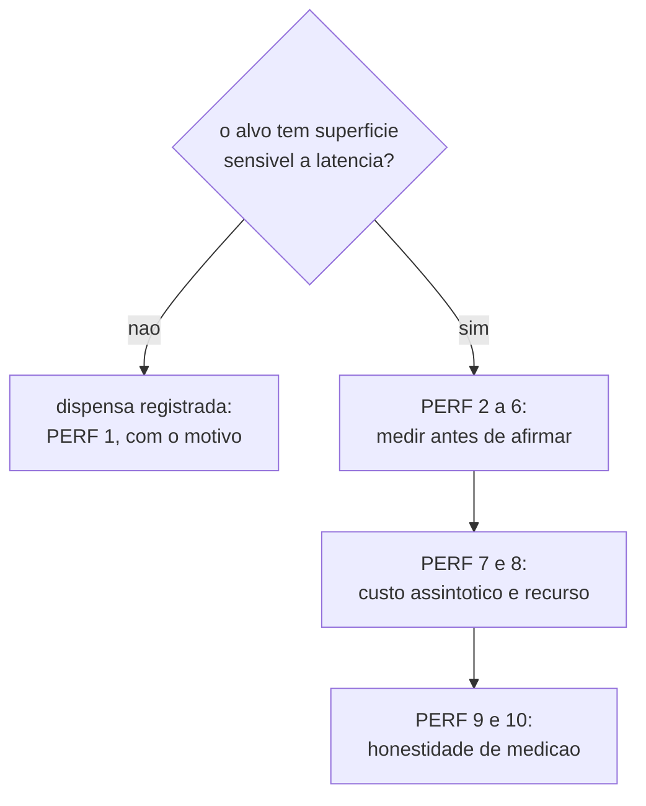

# Performance Checklist

The conditional audit: it runs when the target has a surface that suffers from latency, and when it does
not have one, it is waived by a written contract, never by oversight. Items are numbered only
once across the whole file. Cite an item as `PERF 2`.

**Sources:** [code-review-axes.md](code-review-axes.md) (axis 3),
[definition-of-done.md](definition-of-done.md), `core/src/verify.ts`.

## The waiver contract

| # | Check | How it is proven |
|---|---|---|
| 1 | When the target has no web surface and no latency-sensitive path, the audit is waived with a line saying what the target is and why it has no such surface. A written waiver is a result; a missing audit with no line at all is a gap. | The performance section of the CHECK report, which always exists, even when its content is the waiver. |

## Measure before asserting

| # | Check | How it is proven |
|---|---|---|
| 2 | Every performance statement carries a number, a unit and how the number was obtained. "It got faster" without a measurement is opinion, and opinion does not pass a gate. | The report's measurement table, with the command that produced each number. |
| 3 | There is a measurement before and after, on the same machine and under the same conditions. Comparing measurements from different machines compares machines, not code. | The two runs, with the machine and the conditions declared. |
| 4 | The measurement was repeated enough to separate signal from noise, and the variation is stated. A single run becomes `estimated`, never `runtime_reported`. | The number of repetitions in the report. |
| 5 | The measured path is the user's path, not the convenient microbenchmark. A gain in a function nobody calls on the hot path is a suggestion, not a result. | The stretch of the real flow that the measurement covers. |
| 6 | A detected performance regression is categorized like any other finding: blocker, recorded warning or suggestion. | [code-review-axes.md](code-review-axes.md), categorization rule. |

## Asymptotic cost and resources

| # | Check | How it is proven |
|---|---|---|
| 7 | A loop over a collection that grows with use was examined, and the order of magnitude is stated. A quadratic hidden in small data is a defect with a date already set. | Reading the diff at the points that iterate over accumulated state. |
| 8 | Repeated work inside a loop (file read, process call, parsing the same data) was pointed out, or it was stated that there is none. In `ork`, reading the whole ledger per event would be exactly this defect. | Reading the diff against the I/O points. |

## Measurement honesty

| # | Check | How it is proven |
|---|---|---|
| 9 | Every number carries its source: `runtime_reported`, `estimated` or `unavailable`. It is the same discipline as the `ork` token gate, which would rather say "not measurable" than invent a window occupancy. | The source attached to each number in the report. |
| 10 | What was not measured shows up as `unavailable` with the reason, never as zero, never as a silent absence. A published gap is a gap; a hidden gap becomes a false number on the next reading. | The metrics section of the report. |

## Recommendations (not a gate on this machine)

- Browser profiling tool (Lighthouse, CPU traces): not installed here. A web performance audit
  of a target with a web surface comes out `unavailable` with the reason while that is the case.
- Continuous benchmarking with history: out of reach for this machine; the before-and-after comparison is
  done in the thread itself, with an explicit `PERF 3`.
