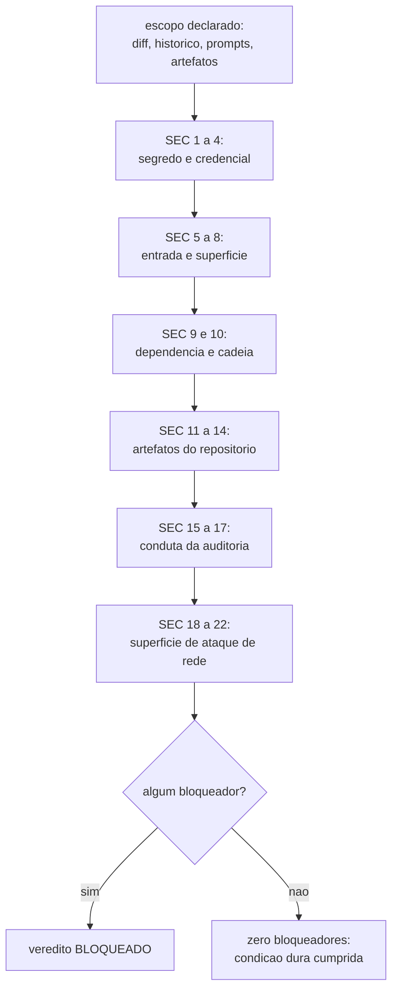

# Security Checklist

The normative list that the CHECK security audit walks through, whose hard pass condition is
zero blockers in the consolidated report. It elevates checks that already exist in the core and
invents none. Items are numbered only once across the whole file. Cite an item as `SEC 5`.

**Sources:** `core/src/policies.ts` (secret patterns and blocking policies),
`core/src/doctor.ts`, `core/src/ship.ts`, `core/src/gates.ts`,
`core/src/superficie.ts` (deterministic scan of the network attack surface,
rules SP8..SP12 of the `security-privacy` pack),
[definition-of-done.md](definition-of-done.md).

## Secrets and credentials

| # | Check | How it is proven |
|---|---|---|
| 1 | No secret in the working tree: token, API key, password, private key block, connection string and high-entropy string that looks like a credential, including `.env` files, test fixtures and example configs. | Reading of the branch diff plus a scan of the tree. The report names the tool used or says the pass was manual. |
| 2 | No secret in the history behind the branch. A secret committed and later deleted is still leaked. | `git log -p <base>..HEAD` over the whole range, not just the tree. Blocker until the credential is rotated and the history cleaned, with the rotation verified, not promised. |
| 3 | No real credential in a dispatched prompt. The `phase.dispatch` gate of `ork` evaluates the `segredo_em_prompt` policy BEFORE writing the prompt to disk: a rejected prompt never comes to exist as a file, because writing a prompt with a credential creates a second leak inside the repository itself. | `ork phase run` exits with typed reason `policy.violation`; the ledger records the pattern name and the line, never the matched excerpt. |
| 4 | No real credential in a thread artifact, the ledger, captured command output or the audit report itself. A leak report that prints the secret is a second leak. | Reading of the artifacts the thread produced. A redacted placeholder passes and is declared as such; a credential is referenced by location and redacted form. |

## Input and surface

| # | Check | How it is proven |
|---|---|---|
| 5 | Every input that crosses a trust boundary is validated on the trusting side, not on the calling side. Client-only validation counts as missing. | Reading of the diff at the touched entry points. |
| 6 | No concatenation of input into SQL, shell, file path or rendered template. The `ork` core runs commands as an argument list, with no interpolated shell, and the same pattern applies to the reviewed code. | Reading of the diff; any command built by concatenation is a blocker. |
| 7 | Authentication and authorization checked per operation, not per screen: whoever can read cannot always write, and either the test that proves this exists or the finding is a warning with a record. | Authorization tests in the suite, rerun by `ork verify`. |
| 8 | Deserialization of untrusted data does not instantiate arbitrary types, and every `JSON.parse` of a state file has its error handled with the path in the error text. | Reading of the diff over the points that read state. |

## Dependencies and supply chain

| # | Check | How it is proven |
|---|---|---|
| 9 | No new dependency without justification in the PLAN. A dependency that comes in without a task is scope creep with an attack surface. | Diff of the package manifest files against the PLAN tasks. |
| 10 | Known vulnerabilities in the declared dependencies were looked up, and the result is in the report with the date and the tool. Where there is no tool, the item comes out `unavailable` with the reason. | `npm audit` where a production dependency is declared. |

## Repository artifacts

| # | Check | How it is proven |
|---|---|---|
| 11 | No mass destructive command in a script, hook or documentation that someone will copy: `rm -rf` with an unanchored variable path, `git add -A`, `git checkout -- .`, `git reset --hard` without a target, `push --force`. | Scan of the touched directories. The `PreToolUse` guard of the Claude Code adapter blocks these same commands at run time. |
| 12 | No direct push to the base branch. The manifest's `push_direto_na_base` policy is blocking and rejects any delivery whose source and target are the same branch. | `ork ship` exits with `policy.violation` before touching the remote. |
| 13 | No dispatch through a paid provider when the policy is `subscription-only`. An environment variable that redirects `claude` to a paid provider is a blocker, because the cost shows up on the bill and not at the gate. | `ork doctor` and the `provider` policy, evaluated at the `phase.dispatch` gate and in `ship`. |
| 14 | Permissions on a file created by a script do not widen access: no `chmod 777`, no state file with the execute bit. | Reading of the diff of the scripts and hooks. |

## Audit conduct

| # | Check | How it is proven |
|---|---|---|
| 15 | The audited scope is declared before the findings: which directories, which history range, which artifacts. An audit without a declared scope is not reproducible and does not count as evidence. | The header of the report's security section. |
| 16 | Each finding comes out categorized as blocker, warning or suggestion, with the `SEC n` item it violates. A finding without an item number is opinion. | The report's findings table. |
| 17 | Absence of findings is stated as the result of a check, with what was looked at. "Nothing found" without a scope is different from "audited and clean", and the difference is written down. | The section text, against `SEC 15`. |

## Network attack surface

What the product EXPOSES. Items 5 to 8 look at the data that comes in through a boundary; these look at
the boundary itself: which routes and endpoints exist, who can call them and at what cost. The
`security-privacy` pack audits this section with a DETERMINISTIC scan (`ork audit surface`, rules
SP8 to SP12), which runs inside `ork audit run security-privacy` and writes each finding to the
debt board with `arquivo:linha` evidence and the command that reruns it.

| # | Check | How it is proven |
|---|---|---|
| 18 | Every HTTP/API server route declared in production goes through an authentication/authorization layer, or is public by a recorded decision (login, sign-up, health, signed webhook). A route that is public by oversight is a blocker. | `ork audit surface --regra SP8`. The finding brings the route definition with `arquivo:linha`, the recognized framework and the command that proves the absence of a guard in the route block or in the file. |
| 19 | An administration or operations endpoint (admin, console, debug, swagger/openapi, detailed health, metrics, `pprof`, cluster metadata) is not reachable from outside: there is a network restriction (allowlist, internal network) or oAuth/basic auth. A health check that returns version, hostname, database or dependency is an operations endpoint, not a health one. | `ork audit surface --regra SP9`, plus the network configuration or the middleware cited with `arquivo:linha`. |
| 20 | An exposed route has a rate limit per IP and per identity, with special attention to the authentication path, password recovery, OTP, search, export and any public route that changes state. Without a limit, a brute-force costs no more than a request. | `ork audit surface --regra SP10`. Limit, quota or rpm middleware cited on the route, on the router that mounts it or on the gateway, with the file and the line. |
| 21 | CORS does not combine a global origin with credentials, and an open origin does not appear in a service that carries personal data or sessions. An explicit list of origins, always. | `ork audit surface --regra SP11`. The finding cites the configuration with `arquivo:linha`, the origin wildcard and the credentials flag, each with the command that reruns it. |
| 22 | The route definition declares the payload schema at the edge (schema, validator, typed model), and an invalid payload is rejected before the handler. Complements item 5, which looks at the USE of the data inside the handler. | `ork audit surface --regra SP12`, with the route definition and the absence of a schema at the entry point. |

A finding that the scan marks with confidence `baixa` (low: there is middleware that `ork` does not classify,
an unrecognized framework, a marker present in the file and absent from the route block) comes out as a
**warning that asks for human confirmation**, never as a blocker: the machine says where to look, and
the person decides whether it holds.

## Recommendations (not a gate on this machine)

- Scanning with a dedicated secret tool (gitleaks, trufflehog): not installed here. The
  patterns in `core/src/policies.ts` cover Anthropic keys, OpenAI keys, AWS access keys, GitHub
  tokens, PEM private keys and secret assignments in text, and the audit says it covered those
  classes and no others.
- Software composition analysis and artifact signing: out of reach for this machine; it comes out
  `unavailable` with the reason, never as a silent pass.
- Dynamic surface testing (port scanning, endpoint fuzzing, DAST): out of reach.
  The scan for items 18 to 22 is STATIC and reads the route definition in the code: it does not see
  routes generated at run time, nor a proxy, gateway or WAF in front of the service. Where that
  layer exists, the finding still stands as a question and is resolved with the layer's evidence, never
  in silence.
