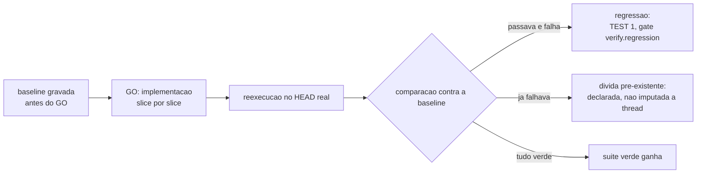

# Testing Patterns

What a suite must prove and how a green suite is earned honestly. Items are numbered
only once across the whole file. Cite an item as `TEST 3`.

**Sources:** `core/src/verify.ts` (baseline and re-run), `core/src/claims.ts`,
[definition-of-done.md](definition-of-done.md), [code-review-axes.md](code-review-axes.md).

## What the suite proves

| # | Check | How it is proven |
|---|---|---|
| 1 | There is a baseline recorded before GO. Without it, a failure cannot tell a regression from pre-existing debt, and the thread takes the blame for a defect that was already there or, worse, hides what it broke itself. | `ork verify <thread> --baseline` before GO. |
| 2 | Every GOAL success criterion has a command that proves it. A criterion that does not become a command is not a criterion, it is an adjective. | The thread's claims, with `--verificar`. |
| 3 | In a fix request, there is a test that reproduces the defect and that failed before the fix. A fix whose defect was never reproduced cannot prove it fixed anything. | The new test, run against the commit before the fix. |
| 4 | The failure path has a test, not only the happy path. A suite that only exercises success measures optimism. | Reading the suite against the PLAN edge cases. |
| 5 | A new test fails when the implementation is reverted. A test that passes with and without the change does not test the change. | Revert locally and run, or mutate the central line and confirm the failure. |

## How the green suite is earned

| # | Check | How it is proven |
|---|---|---|
| 6 | The suite runs on the real HEAD, in the thread's working directory. A pass reported by an agent is not a pass. | `ork verify <thread>` re-runs the manifest commands and the claims, and stamps the real commit. |
| 7 | No test was disabled, marked to skip or loosened to close the delivery. Skipping a test is a recorded scope change, never a silent course correction. | Diff over the test files, looking for removed tests, `skip` and relaxed assertions. |
| 8 | No assertion was swapped for the value the code produces today without someone saying why the right value changed. Adjusting the expected to the observed is the most common way to turn a defect into a contract. | Diff of the assertions against the intent declared in the PLAN. |
| 9 | A test does not depend on the network, on a paid credential or on the wall clock. A deterministic fixture is the standard; whatever needs the outside world stays out of the gate and is declared. | Run the suite offline. In `ork`, the `ork eval` canaries build a temporary git repository and do not touch the network. |
| 10 | A test does not depend on another test or on the execution order. State shared between cases is a defect, even when the suite is green today. | Run the suspect case in shuffled order or in isolation. |

## Count and coverage

| # | Check | How it is proven |
|---|---|---|
| 11 | The reported test count is the one the command printed, pasted from the real output. A suite number typed from memory is not evidence. | The runner output in the delivery report. |
| 12 | Coverage is reported with its source: `runtime_reported` when the tool measured it, `estimated` when someone estimated it and said so, `unavailable` when there is no tool. A gap is published as a gap, never as zero. | The metrics section of the report. |

## Recommendations (not a gate on this machine)

- Tool-measured coverage: this repository has no such tool installed, so coverage comes out
  `unavailable` per `TEST 12`, and is not estimated for convenience.
- Mutation testing to prove `TEST 5` automatically: out of reach for this machine; the proof
  here is manual and declared as manual.
